# Mapillary reference photos of Narromine

Street-level photos from [Mapillary](https://www.mapillary.com), licensed
[CC BY-SA 4.0](https://creativecommons.org/licenses/by-sa/4.0/). Each photo is credited to its
photographer below. They are kept here as references for making Repository Town's Narromine true to
life, for the review spots in [NARROMINE_STREETVIEW_REVIEW.md](../NARROMINE_STREETVIEW_REVIEW.md).
Regenerate with `MAPILLARY_TOKEN=... node tools/mapillary-snapshots.mjs`.

| Spot | Photo | Photographer | Captured | Mapillary image |
|---|---|---|---|---|
| Dandaloo St at the Narromine Hotel | 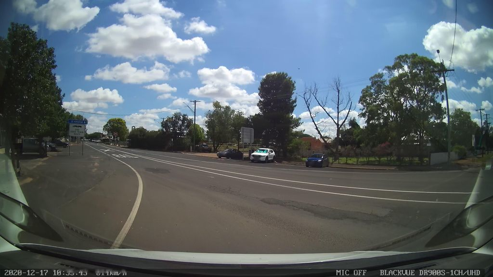 | bob3bob3 | 2020-12-16 | [117770907024882](https://www.mapillary.com/app/?pKey=117770907024882) · 4 m away, facing 39° |
| Dandaloo St at the Narromine Hotel | 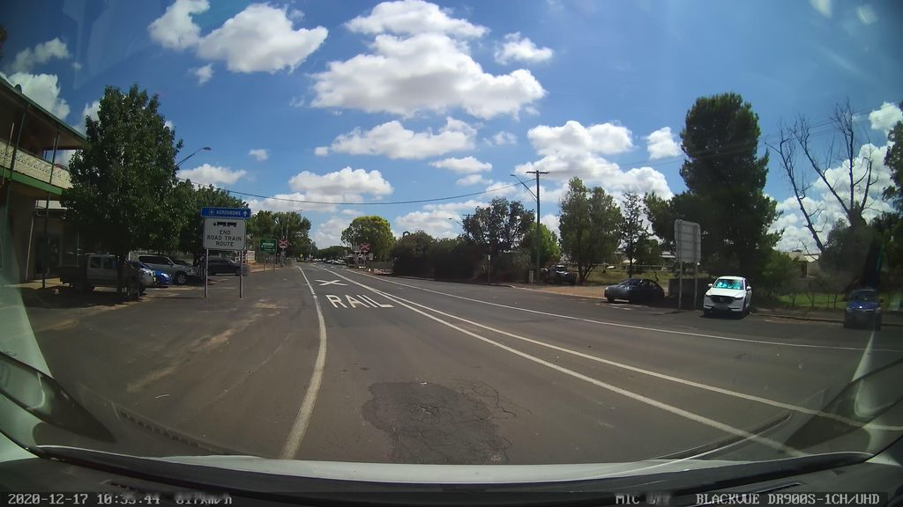 | bob3bob3 | 2020-12-16 | [1176175669554940](https://www.mapillary.com/app/?pKey=1176175669554940) · 13 m away, facing 17° |
| Dandaloo St at the post office | 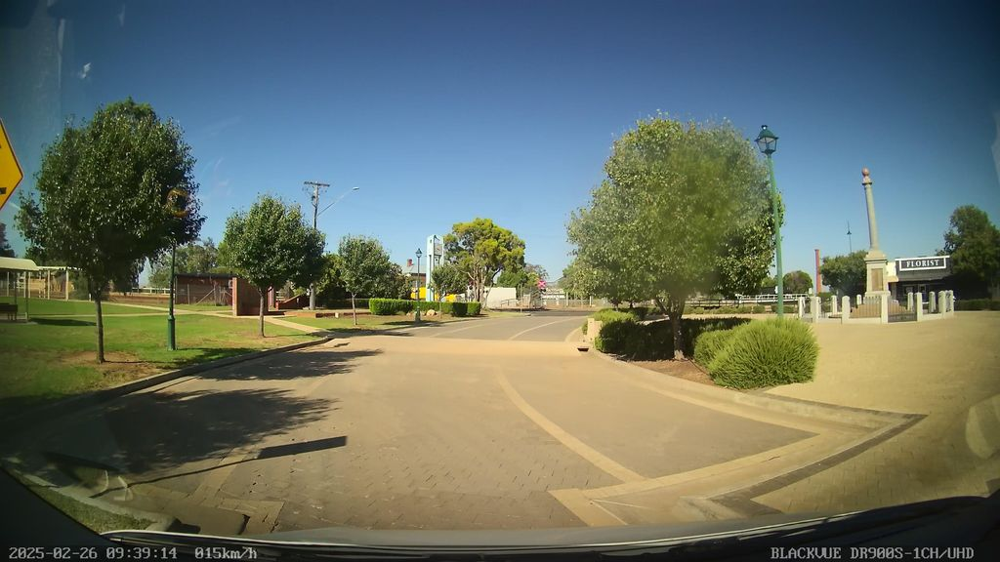 | bob3bob3 | 2025-02-25 | [2636747406533326](https://www.mapillary.com/app/?pKey=2636747406533326) · 78 m away, facing 224° |
| Dandaloo St at the post office | 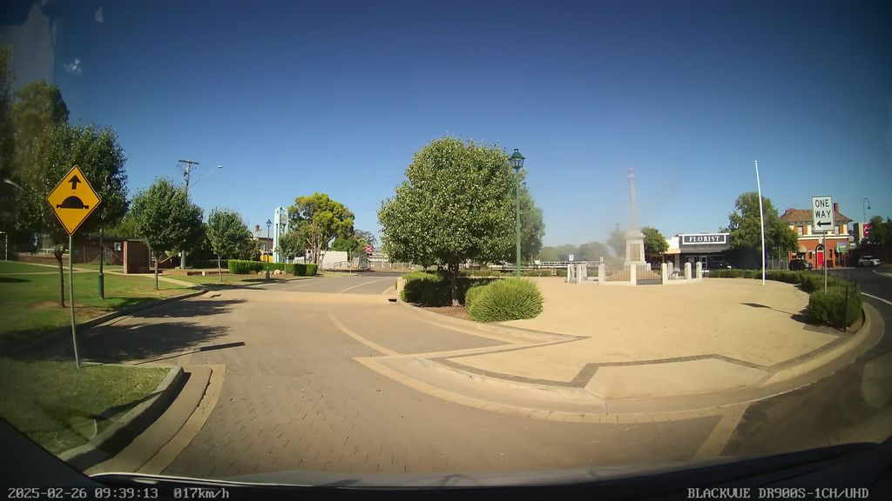 | bob3bob3 | 2025-02-25 | [519320381190928](https://www.mapillary.com/app/?pKey=519320381190928) · 80 m away, facing 241° |
| Dandaloo St north block | 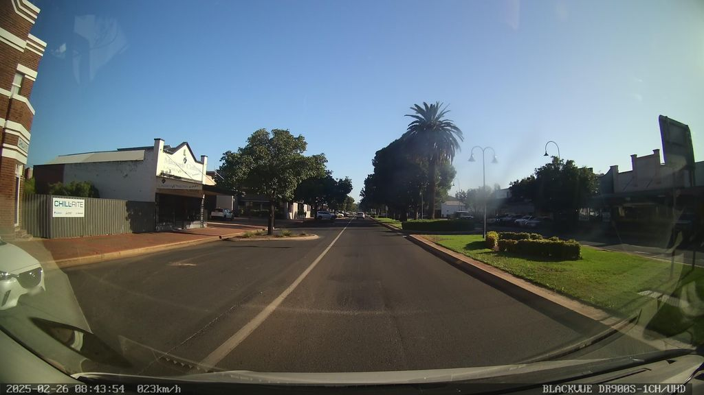 | bob3bob3 | 2025-02-25 | [1046391767529891](https://www.mapillary.com/app/?pKey=1046391767529891) · 84 m away, facing 9° |
| Dandaloo St north block | 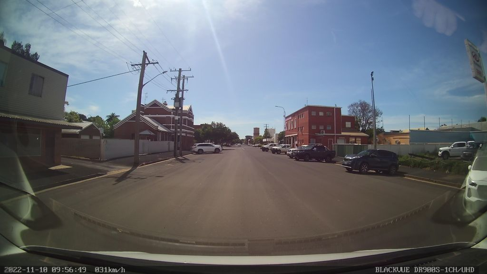 | bob3bob3 | 2022-11-09 | [183078724270209](https://www.mapillary.com/app/?pKey=183078724270209) · 85 m away, facing 101° |
| Burraway St by Monaghan's Butchery | (no Mapillary photo within 80 m) | | | |
| Station and Dandaloo St level crossing | 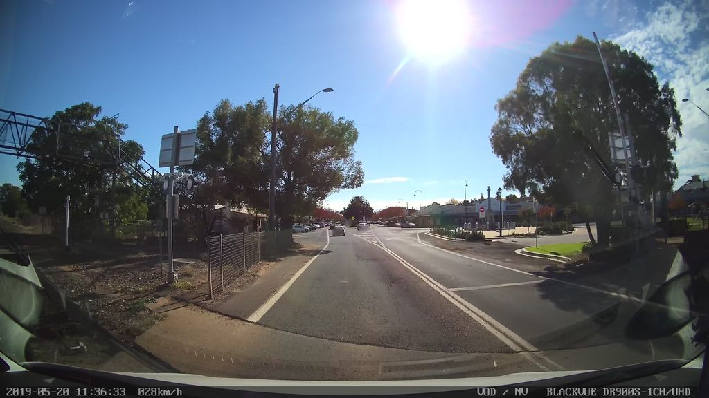 | bob3bob3 | 2019-05-20 | [152158550208919](https://www.mapillary.com/app/?pKey=152158550208919) · 16 m away, facing 7° |
| Station and Dandaloo St level crossing | 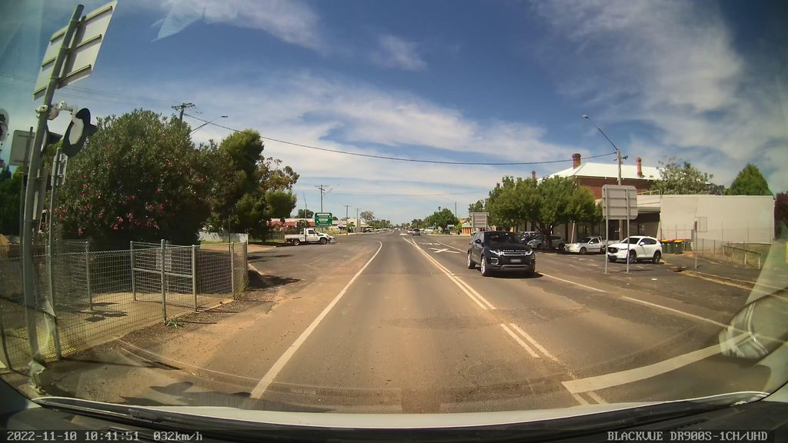 | bob3bob3 | 2022-11-09 | [1066245134042818](https://www.mapillary.com/app/?pKey=1066245134042818) · 17 m away, facing 188° |
| Residential street west of Dandaloo St | 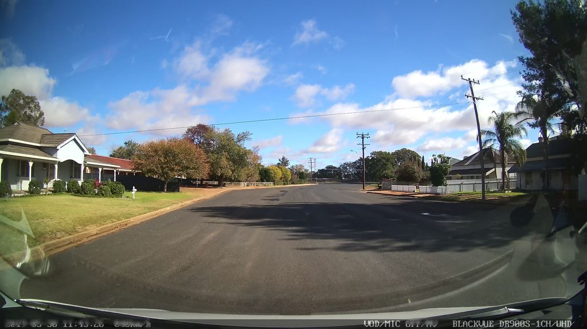 | bob3bob3 | 2019-05-30 | [762939954586653](https://www.mapillary.com/app/?pKey=762939954586653) · 65 m away, facing 284° |
| Residential street west of Dandaloo St | 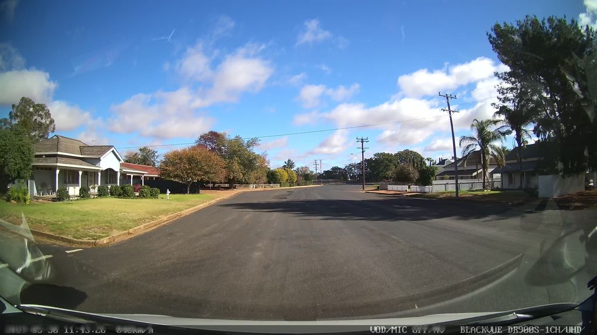 | bob3bob3 | 2019-05-30 | [526034521738464](https://www.mapillary.com/app/?pKey=526034521738464) · 65 m away, facing 284° |
| Silo Access Road crossing | 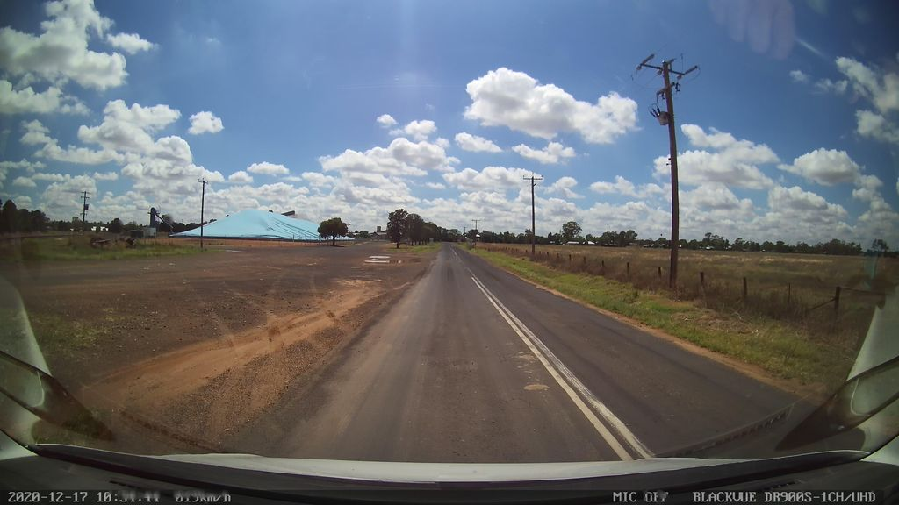 | bob3bob3 | 2020-12-16 | [910213466427519](https://www.mapillary.com/app/?pKey=910213466427519) · 4 m away, facing 97° |
| Silo Access Road crossing | 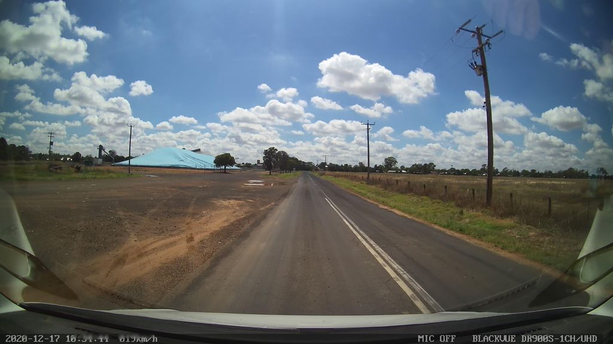 | bob3bob3 | 2020-12-16 | [436576197378519](https://www.mapillary.com/app/?pKey=436576197378519) · 5 m away, facing 97° |
| Manildra Street level crossing | 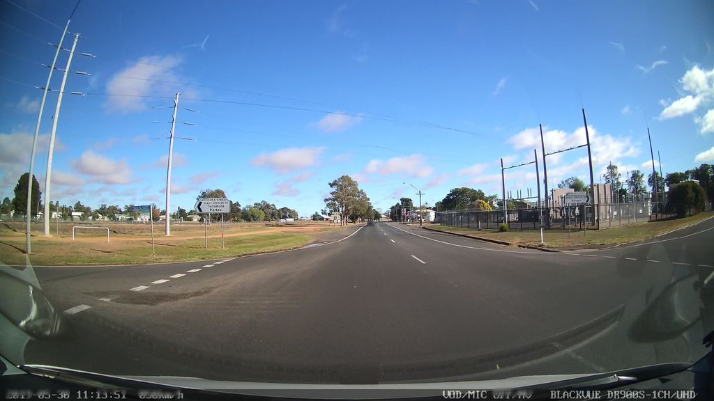 | bob3bob3 | 2019-05-30 | [3966012956822749](https://www.mapillary.com/app/?pKey=3966012956822749) · 33 m away, facing 293° |
| Manildra Street level crossing | 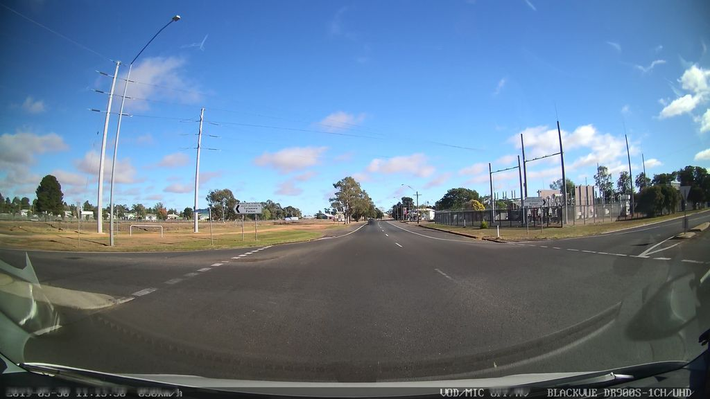 | bob3bob3 | 2019-05-30 | [516874803003816](https://www.mapillary.com/app/?pKey=516874803003816) · 33 m away, facing 291° |
| Mitchell Highway entering from Dubbo | (no Mapillary photo within 80 m) | | | |
| Back street east of Dandaloo St | (no Mapillary photo within 80 m) | | | |
